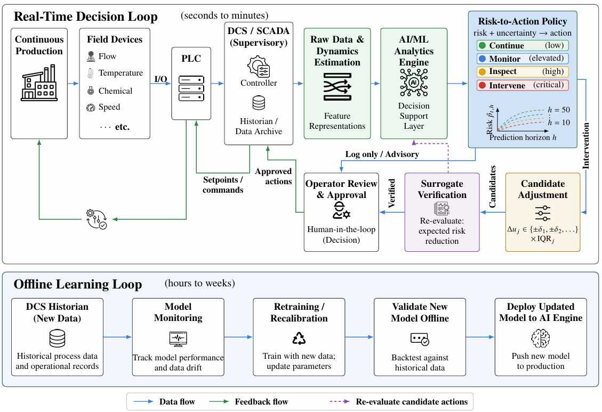

# Multi-Horizon Early Warning
This is a companion repository which contains the Pytorch implementation of the manuscript - [Dynamics-Augmented Multi-Horizon Early Warning for Extremely Rare Events in Industrial Processes]

<div align="center">
  
</div>


## Result


### Event-Level Performance 
Comparison of raw, dynamics-only, and dynamics-augmented
representations across four predictive models.

**Results are reported as mean ± standard deviation over 5 seeds (42, 52, 62, 72, 82)**

| Model | Representation | AUPRC ↑ | AUROC ↑ | BS ↓ | F1 ↑ |
|:------|:---------------|--------:|--------:|-----:|-----:|
| **HGB** | Raw | 0.22 ± 0.008 | 0.50 ± 0.018 | 0.22 ± 0.001 | 0.24 ± 0.026 |
| | Dyn-only | 0.41 ± 0.042 | 0.64 ± 0.012 | 0.18 ± 0.008 | 0.27 ± 0.026 |
| | Dyn-aug | 0.40 ± 0.015 | 0.62 ± 0.017 | 0.18 ± 0.005 | 0.12 ± 0.072 |
| **XGB** | Raw | 0.27 ± 0.015 | 0.55 ± 0.017 | 0.21 ± 0.002 | 0.07 ± 0.052 |
| | Dyn-only | 0.45 ± 0.031 | 0.64 ± 0.015 | 0.17 ± 0.006 | 0.33 ± 0.040 |
| | Dyn-aug | 0.45 ± 0.018 | 0.64 ± 0.006 | 0.17 ± 0.004 | 0.19 ± 0.091 |
| **LSTM** | Raw | 0.38 ± 0.107 | 0.60 ± 0.088 | 0.26 ± 0.046 | 0.23 ± 0.211 |
| | Dyn-only | 0.20 ± 0.016 | 0.43 ± 0.038 | 0.30 ± 0.120 | 0.11 ± 0.048 |
| | Dyn-aug | 0.24 ± 0.045 | 0.48 ± 0.071 | 0.41 ± 0.118 | 0.10 ± 0.080 |
| **TCN** | Raw | 0.28 ± 0.074 | 0.56 ± 0.068 | 0.33 ± 0.137 | 0.14 ± 0.166 |
| | Dyn-only | 0.23 ± 0.018 | 0.43 ± 0.039 | 0.52 ± 0.156 | 0.14 ± 0.035 |
| | Dyn-aug | 0.23 ± 0.016 | 0.44 ± 0.038 | 0.72 ± 0.024 | 0.06 ± 0.043 |


### Event-level performance on different representations 

| Model | Rep.     | Mean Lead    | H_e           | Utility       | A_time (%)     |
|-------|----------|--------------|---------------|---------------|----------------|
| HGB   | Raw      | 23.5 ± 1.31  | 0.56 ± 0.087  | 0.07 ± 0.056  | 30.8 ± 5.21    |
|       | Dyn-only | 26.3 ± 1.08  | 0.47 ± 0.059  | 0.36 ± 0.070  | \*6.4 ± 1.27   |
|       | Dyn-aug  | 21.7 ± 2.16  | 0.31 ± 0.142  | 0.28 ± 0.129  | \*2.5 ± 1.97   |
| XGB   | Raw      | 20.9 ± 3.81  | 0.26 ± 0.118  | 0.18 ± 0.071  | \*3.7 ± 2.59   |
|       | Dyn-only | 26.3 ± 1.85  | 0.55 ± 0.026  | 0.41 ± 0.031  | \*7.5 ± 1.15   |
|       | Dyn-aug  | 23.3 ± 1.80  | 0.48 ± 0.079  | 0.44 ± 0.062  | \*3.3 ± 2.03   |
| LSTM  | Raw      | 28.1 ± 0.66  | 0.49 ± 0.457  | 0.07 ± 0.116  | 29.8 ± 32.14   |
|       | Dyn-only | 20.9 ± 3.31  | 0.32 ± 0.150  | 0.05 ± 0.052  | 11.4 ± 7.12    |
|       | Dyn-aug  | 21.3 ± 3.46  | 0.26 ± 0.178  | 0.10 ± 0.117  | \*6.3 ± 4.43   |
| TCN   | Raw      | 22.3 ± 4.18  | 0.27 ± 0.305  | 0.10 ± 0.098  | 12.5 ± 17.96   |
|       | Dyn-only | 25.8 ± 1.09  | 0.23 ± 0.076  | 0.11 ± 0.050  | \*8.2 ± 6.88   |
|       | Dyn-aug  | 19.2 ± 4.65  | 0.15 ± 0.042  | 0.13 ± 0.035  | \*1.0 ± 0.73   |

Values are mean ± standard deviation over 5 random seeds (42, 52, 62, 72, 82).
Mean Lead: mean warning lead time (observations); H_e: event hit rate;
Utility: operational utility; A_time: time under alarm on the test set.
\* Mean time under alarm below the 10% alarm-time limit.

**Notes:**
- **Raw:** Original sensor measurements.
- **Dyn-only:** Features derived from process dynamics.
- **Dyn-aug:** Combination of raw and dynamics features.
- **↑:** Higher is better.
- **↓:** Lower is better.
- **BS:** Brier Score.


## Citation
```
@article{dyn_awr_2026,
  title   = {Dynamics-Augmented Multi-Horizon Early Warning for Extremely Rare Events in Industrial Processes},
  author  = {Anonymous Author(s)},
  journal = {IEEE Access (under review)},
  year    = {2026}
}
```

